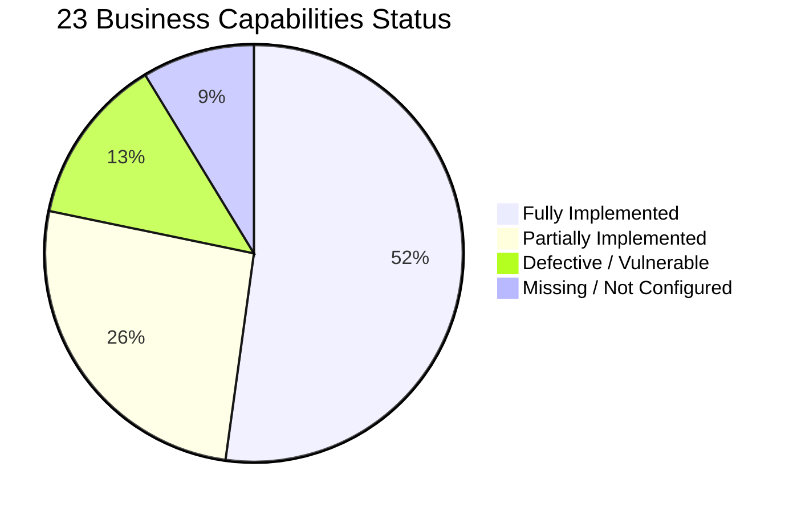

# Backend Architecture & 23-Feature Business Capability Audit — Kirb Gebeya

## 1. Application Bootstrapping & Routing Topology

### Routing Organization
The primary application (`public_html/`) defines its route architecture across multiple files in `routes/`:
- `routes/web.php` — Core public storefront, homepage sections, customer authentication, and static informational pages.
- `routes/admin.php` — Administrative back-office management, business configuration, staff roles, and analytics.
- `routes/seller.php` — Multi-vendor merchant dashboard, product listing, order fulfillment, and commission withdrawal.
- `routes/api.php` — Flutter / Mobile REST API routes authenticated via Laravel Sanctum / JWT tokens.
- `routes/affiliate.php` — Affiliate partner portal, link generator, commission logs, and withdrawal requests.

### Middleware Pipeline
- `App\Http\Middleware\IsAdmin`: Guarding administrative dashboard routes (`/admin`).
- `App\Http\Middleware\IsSeller`: Guarding multi-vendor merchant portal (`/seller`).
- `App\Http\Middleware\IsCustomer`: Guarding customer order history and profile settings (`/dashboard`).
- `App\Http\Middleware\Language`: Resolving active locale from session or fallback configuration.
- `App\Http\Middleware\CurrencyManager`: Setting active currency context.
- `App\Http\Middleware\VerifyCsrfToken`: Excludes payment webhooks, but contains unauthenticated security risks (`/import-data`).

---

## 2. 23-Feature Business Capability Matrix



| # | Business Feature | Status | Primary Controller / Component | Detailed Audit Finding |
|---|---|---|---|---|
| 1 | **Customer Registration & Auth** | Fully Implemented | `Auth\LoginController`, `Auth\RegisterController` | Supports email and phone-based OTP registration. Social login (Google, Facebook, Apple) present. |
| 2 | **Customer Profile & Account** | Fully Implemented | `CustomerController`, `AddressController` | Profile editing, multi-address book, default shipping/billing assignment operational. |
| 3 | **Product Catalog** | Fully Implemented | `ProductController`, `ProductService` | Supports physical and digital products, multi-variant combinations (colors, sizes, attributes). |
| 4 | **Product Categories** | Fully Implemented | `CategoryController`, `CategoryUtility` | Nested parent-child category tree with banner images and icon uploads. |
| 5 | **Product Search & Filtering** | Partially Implemented | `SearchController.php` | SQL `LIKE %...%` query search with attribute/brand/price filters. **Lacks Amharic stemmer support and full-text index**. |
| 6 | **Product Details View** | Fully Implemented | `ProductController.php` | Displays gallery, discount calculation, stock quantity selector, description tabs, and related items. |
| 7 | **Shopping Cart** | Fully Implemented | `CartController.php` | Supports guest session cart and authenticated database cart merging upon customer login. |
| 8 | **Checkout Pipeline** | Partially Implemented | `CheckoutController.php` | 4-stage wizard: Shipping address -> Delivery method -> Payment selection -> Confirmation. Suffers from session expiration drops. |
| 9 | **Orders & Tracking** | Fully Implemented | `OrderController.php`, `InvoiceController` | Generates alphanumeric tracking codes. Dedicated public `/track-your-order` interface working properly. |
| 10 | **Payment Processing** | **Defective / Incomplete** | `Payment\ChapaController`, `CashOnDeliveryController` | **Chapa** integrated for ETB, but uses unindexed string search on `orders.payment_details`. **Telebirr is completely missing**. |
| 11 | **Refunds & Returns** | Fully Implemented | `RefundRequestController.php` | Customer return dispute workflow with admin approval, wallet credit, or rejection logging. |
| 12 | **Seller Onboarding** | Fully Implemented | `ShopController.php` | Public registration `/shops/create`, business license upload, and administrative verification gate. |
| 13 | **Seller Dashboard** | Fully Implemented | `Seller\SellerController.php` | Merchant dashboard for sales volume, current earnings, product count, and pending orders. |
| 14 | **Seller Product Management** | Fully Implemented | `Seller\ProductController.php` | Merchants can draft, publish, and manage variant inventories subject to admin moderation settings. |
| 15 | **Inventory Management** | Partially Implemented | `ProductStock.php`, `ProductService.php` | Variant-level stock decrementing on checkout. Lacks automated low-stock vendor notifications. |
| 16 | **Seller Reviews & Ratings** | Fully Implemented | `ReviewController.php` | Customer star ratings and text feedback with admin moderation before public display. |
| 17 | **Affiliate System** | Fully Implemented | `AffiliateController.php` | Partner onboarding, custom referral URL generator, commission calculation, and withdrawal requests. |
| 18 | **Coupons & Flash Deals** | Fully Implemented | `CouponController.php`, `FlashDealController` | Percentage and fixed cart discounts, flash sale countdown timers, and product inclusion gates. |
| 19 | **Auctions & Bidding** | Partially Implemented | `AuctionProductController.php` | Addon schema exists; backend controllers support bidding, but disabled by default in settings. |
| 20 | **Notifications** | Partially Implemented | `NotificationController.php` | Database notifications functional. Firebase push & SMS gateway (Twilio) configured but unverified for Ethiopian SMS. |
| 21 | **Customer Support Tickets** | Fully Implemented | `SupportTicketController.php` | Internal ticket creation, file attachment, and threaded reply messaging system. |
| 22 | **Admin Back-Office & RBAC** | Fully Implemented | `AdminController.php`, `RoleController` | Comprehensive Spatie-based permissions, staff management, and system configuration toggles. |
| 23 | **Reports & Analytics** | Fully Implemented | `ReportController.php` | In-house sales reports, seller commission summaries, product wishlists, and search keyword logs. |

---

## 3. Deep Dive: Critical Backend Deficiencies

### A. Unauthenticated Remote Execution Vector (`/import-data`)
In [routes/web.php](file:///C:/Users/AFRO-EAGLE/kirbgebeya/public_html/routes/web.php#L119):
```php
Route::post('/import-data', 'import_data');
```
Handled in [HomeController.php](file:///C:/Users/AFRO-EAGLE/kirbgebeya/public_html/app/Http/Controllers/HomeController.php):
```php
public function import_data(Request $request)
{
    $upload_path = $request->file('uploaded_file')->store('uploads', 'local');
    $sql_path = $request->file('sql_file')->store('uploads', 'local');
    
    $zip = new ZipArchive;
    $zip->open(base_path('public/'.$upload_path));
    $zip->extractTo('public/uploads/all');

    $zip1 = new ZipArchive;
    $zip1->open(base_path('public/'.$sql_path));
    $zip1->extractTo('public/uploads');

    Artisan::call('cache:clear');
    $sql_path = base_path('public/uploads/demo_data.sql');
    DB::unprepared(file_get_contents($sql_path));
}
```
**Impact**: Anyone on the internet can send arbitrary POST payloads to unpack malicious PHP webshells into `public/uploads/all` and execute arbitrary raw SQL against the production database.

### B. Unindexed Payment Callback Query
In [ChapaController.php](file:///C:/Users/AFRO-EAGLE/kirbgebeya/public_html/app/Http/Controllers/Payment/ChapaController.php#L104):
```php
$order = Order::where('payment_details', 'like', '%"tx_ref":"'.$tx_ref.'"%')->first();
```
`payment_details` is a text/json column without an index. Every single payment verification callback forces a full table scan across all historical orders. A dedicated indexed column `transaction_reference` is required.

### C. Obfuscated Vendor Telemetry (`myText.txt`)
Planting hidden `mail()` execution using `chr(...)` across 7 core controllers violates enterprise security standards and leaks production domain metadata to third parties without administrator knowledge.
