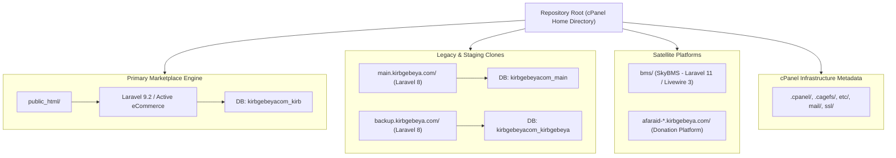
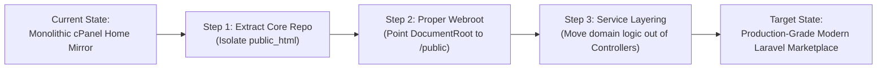

# Codebase Architecture & Monorepo Topology Audit — Kirb Gebeya

## 1. Monorepo Architectural Reality

The Kirb Gebeya repository does not follow standard standalone Laravel repository conventions. Instead, it is a complete **cPanel Home Directory Mirror** (`/home/<user>/`), which houses multiple unrelated applications, subdomains, server configuration files, and backup snapshots.

---

## 2. Directory Breakdown & Component Inventory

| Directory | Type / Framework | Operational Role | Database Target | Coupling Risk |
|---|---|---|---|---|
| `public_html/` | Laravel 9.2.x (PHP 8.0+) | **Active Production eCommerce Engine** for `kirbgebeya.com` | `kirbgebeyacom_kirb` | High (contains whole webroot + apps) |
| `main.kirbgebeya.com/` | Laravel 8.x (PHP 7.1+) | Historical predecessor / clone of eCommerce platform | `kirbgebeyacom_main` | Medium (stale dependencies & credentials) |
| `backup.kirbgebeya.com/` | Laravel 8.x (PHP 7.1+) | Unmaintained backup copy of eCommerce platform | `kirbgebeyacom_kirbgebeya` | Medium (stale code) |
| `bms/SkyBMS/` | Laravel 11.x (PHP 8.2+) | SkyBMS Business Management System (Jetstream, Livewire 3) | `bms` sqlite/mysql | Low (self-contained service) |
| `home/kirbgebeyacom/bms-services.kirbgebeya.com/` | Node / PHP Services | Backend API microservices supporting BMS | Independent | Low |
| `afaraid-*.kirbgebeya.com/` | PHP / Laravel / Custom | Afar Aid Donation Platform suite | Independent | Low |
| `.cpanel/`, `.cagefs/`, `etc/`, `mail/`, `ssl/` | Server Configs | cPanel email accounts, Dovecot certs, and Apache configs | N/A | **Critical** (Server infrastructure in git) |

---

## 3. Primary Application Inspection (`public_html/`)

### Runtime Stack & Manifests
- **Framework**: Laravel 9.2.x (upgrade from original Laravel 8.x lineage).
- **PHP Compatibility**: Configured for `^8.0.2` in `composer.json`, running locally and on LiteSpeed under PHP 8.4 runtime.
- **Frontend Assets**:
  - `package.json` contains `laravel-mix`, `bootstrap`, `jquery`, `lodash`, and `vue`.
  - Compiled bundles live under `public_html/public/assets/css/` and `public_html/public/assets/js/`.
  - Static asset serving handled via direct streaming in [server.php](file:///C:/Users/AFRO-EAGLE/kirbgebeya/public_html/server.php) locally, and LiteSpeed static rewrite on production.

### Core Application Namespaces
- `App\Http\Controllers`: Monolithic controllers handling both HTTP API logic, Blade view rendering, and transactional database actions.
- `App\Models`: Eloquent active-record entities. Lack model factories or comprehensive relationship constraints.
- `App\Services`: Minimal service abstraction (`ProductService.php`, `ProductTaxService.php`). The majority of domain logic remains embedded inside controllers.
- `App\Utility`: Static helper classes (`CategoryUtility.php`, payment utilities) containing tightly coupled procedural logic.

---

## 4. Architectural Debt & Anti-Patterns

1. **Monorepo / Server Directory Bleed**:  
   Committing cPanel internal structures (`.cpanel`, `mail`, `.cagefs`, `ssl`) into a git repository creates severe git bloat, risk of committing private keys or mail logs, and breaks standard CI/CD deployment pipelines.
2. **Multiple Desynchronized Code Clones**:  
   Having `public_html/`, `main.kirbgebeya.com/`, and `backup.kirbgebeya.com/` in the same git repository causes developer confusion over which directory is production canonical.
3. **Procedural Controller Bloat**:  
   `HomeController.php` (850+ lines), `CheckoutController.php` (500+ lines), and `ProductController.php` (700+ lines) violate Single Responsibility Principles, mixing session manipulation, external API requests, email triggers, and SQL generation.
4. **Heavy Global Helper Dependency**:  
   The application relies heavily on global functions in `app/Http/Helpers.php` (`get_setting()`, `uploaded_asset()`, `translate()`, `filter_products()`). This obscures dependencies and makes automated unit testing virtually impossible without full database booting.

---

## 5. Architectural Modernization Strategy

- **Phase 1**: Isolate `public_html/` into its own clean git repository root. Move BMS and Afaraid into independent micro-repositories.
- **Phase 2**: Reconfigure hosting to point the Web DocumentRoot to `public_html/public/` so that application source code, `.env`, and `vendor/` are physically outside the HTTP access path.
- **Phase 3**: Introduce Service and DTO layers for Order Creation, Inventory Allocation, and Payment Webhook Verification.
