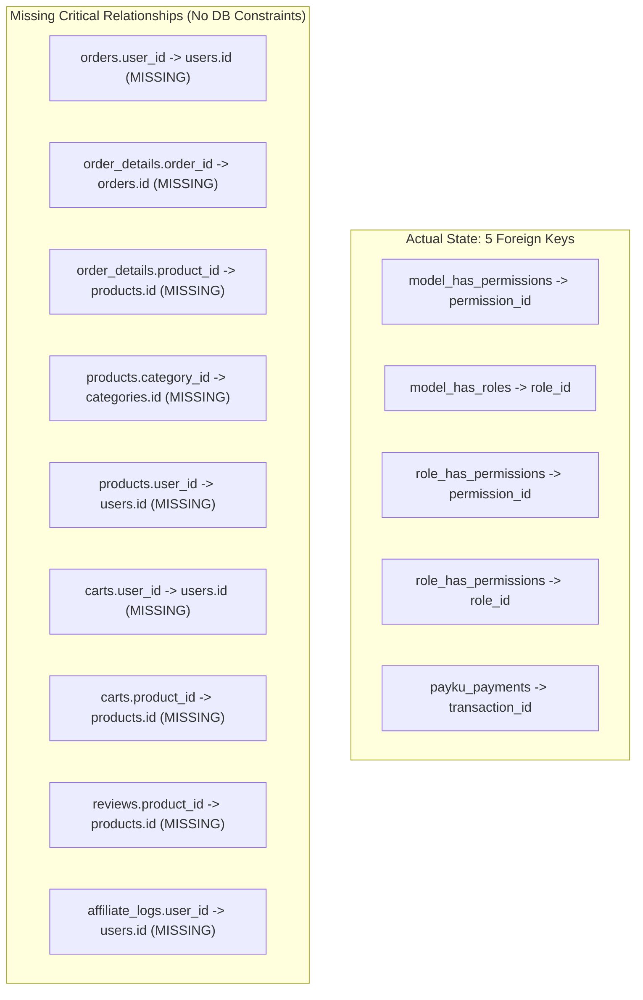

# Database Architecture, Schema Drift & Data Integrity Audit — Kirb Gebeya

## 1. Database Overview & Engine Profile

- **Database Engine**: MariaDB 10.3.39 (WSL local) / MySQL 5.7+ / MariaDB (Production cPanel)
- **Primary Schema**: `kirbgebeyacom_kirb`
- **Total Tables**: 100 tables
- **Storage Engine**: `InnoDB` (all tables)
- **Default Charset / Collation**: `utf8mb4_unicode_ci` / `utf8_unicode_ci`

### Top Tables by Data Volume
1. `cities`: 47,859 records (Global location seed data)
2. `translations`: 26,136 records (i18n UI strings)
3. `states`: 4,091 records
4. `countries`: 246 records
5. `permissions`: 237 records (Spatie permission matrix)
6. `business_settings`: 156 records (Key-value system configurations)
7. `colors`: 143 records

---

## 2. Foreign Key & Referential Integrity Audit



### The 5% Constraint Reality
Across 100 tables, **only 5 foreign key constraints exist in the entire database**.  
Every core e-commerce entity—Orders, Order Details, Products, Stocks, Categories, Carts, and Reviews—relies solely on implicit application-level ID referencing.

### Data Integrity Risks
1. **Orphaned Order Items**: If a merchant or admin deletes a product, historical `order_details` rows referencing that `product_id` remain orphaned with invalid IDs, breaking customer invoice and order details rendering (`InvoiceController` throws null pointer exceptions on `$order_detail->product->name`).
2. **Ghost Cart Items**: Deleted products remain in session/database carts, causing checkout calculations to throw unhandled exceptions.
3. **Broken Soft Deletes**: The application does not consistently implement Laravel SoftDeletes across related tables, leading to partial deletions.

---

## 3. Migration History & Schema Drift Analysis

### The 2-Migration Paradox
Querying the `migrations` table reveals a startling disconnect:
```sql
SELECT * FROM migrations;
-- Returns only 2 records:
-- 1: 2014_10_12_000000_create_users_table
-- 2: 2014_10_12_100000_create_password_resets_table
```
Inspecting `public_html/database/migrations` reveals **only 4 migration files** in the codebase.

### How Was the Database Built?
The database was **not built through Laravel migrations**. It was created via:
1. Monolithic raw SQL dump: `public_html/shop.sql` (7.8 MB).
2. Sequential SQL patch scripts: `public_html/sqlupdates/v15.sql` through `v880.sql`.
3. Add-on SQL update files: `public_html/temp/ALHM4zFlM4/addons/affiliate_system/sql/update.sql`.

> [!CAUTION]
> **Catastrophic Migration Risk**  
> Running `php artisan migrate:fresh` or `php artisan migrate:reset` in this environment will **permanently destroy the database**, wiping all 100 tables and only recreating 4 tables. Developers must NEVER run fresh migrations without reverse-engineering the full schema into Laravel migration classes first.

---

## 4. Affiliate System Schema Verification

The affiliate add-on tables were recently verified and imported into `kirbgebeyacom_kirb`:
- `affiliate_configs`: Stores withdrawal thresholds and verification fields.
- `affiliate_options`: Configures commission rates (user registration, product sharing, category commissions).
- `affiliate_users`: Tracks approved affiliate accounts, PayPal/bank details, and balances.
- `affiliate_payments`: Records payment transactions to affiliates.
- `affiliate_withdraw_requests`: Manages withdrawal approval workflow.
- `affiliate_logs`: Detailed click, referral, and purchase audit trail.
- `affiliate_stats`: Aggregated click and conversion counts.

*All 7 affiliate tables are now fully synchronized with `public_html/shop.sql`.*

---

## 5. Currency & Localization Schema Audit

### Currency Configuration
- `currencies` table contains 25 currencies.
- **Ethiopian Birr (`ETB`)** is successfully registered with ID `29`, Symbol `Br`, exchange rate `1.0`.
- `business_settings.system_default_currency` is set to `29`.

### Language Configuration Deficiency
- `languages` table contains:
  1. `English` (`en`, status = 1)
  2. `Bangla` (`bd`, status = 1)
  3. `Arabic` (`sa`, status = 1)
- **Amharic (`am`)** is completely missing from the database.
- **Recommendation**: Insert Amharic into `languages` table:
  ```sql
  INSERT INTO languages (name, code, rtl, status) VALUES ('Amharic', 'am', 0, 1);
  ```
