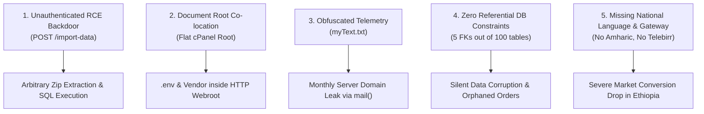

# Executive Summary — Kirb Gebeya Platform Audit

**Platform Target**: Kirb Gebeya eCommerce Marketplace (`kirbgebeya.com`)  
**Repository**: `https://github.com/Bedru-Mekiyu/kirbgebeya.git` (`main` branch @ `5f09b6a`)  
**Auditor**: Senior Staff Software Engineer, Solutions Architect & Tech Lead  
**Audit Date**: November 19, 2026  
**Execution Mode**: Strict Non-Destructive, Read-Only Audit  

---

## 1. High-Level Health & Risk Assessment

| Assessment Dimension | Rating | Summary Finding |
|---|---|---|
| **Overall Platform Health** | **C+ (Marginal / Functioning with Critical Gaps)** | Live platform is operational and serving Ethiopian customers; however, it suffers from critical unauthenticated endpoints, architectural flat-hierarchy risks, missing referential database constraints, and undocumented cPanel monorepo coupling. |
| **Backend Architecture** | **C** | Monolithic Active eCommerce (Laravel 9.2) architecture with thick procedural controllers, heavy reliance on global helpers, and lack of dedicated service/repository layers. |
| **Frontend & User Experience** | **B-** | Brand identity (`#00674F` green, `#FFE600` yellow) and responsive layout are visually aligned on the homepage; however, cart and category discovery suffer from mobile friction and N+1 partial loading bottlenecks. |
| **Database & Integrity** | **D+** | 100 tables in schema, but only **5 foreign key constraints** across the entire database. 96% of tables lack Laravel migrations, relying on raw monolithic SQL dumps (`shop.sql`). Extreme vulnerability to orphaned records. |
| **Security & Privacy** | **D (CRITICAL RISKS)** | **CVSS 10.0 RCE Risk**: Publicly accessible, unauthenticated, CSRF-exempt `/import-data` endpoint capable of unzipping files to webroot and executing arbitrary SQL. Obfuscated phone-home telemetry (`myText.txt` -> `developer.activeitzone@gmail.com`) active in 7 controllers. |
| **Production Synchronization** | **Yellow / Divergent** | While navigation and currency settings match live, production still contains external demo cookie links (`demo.activeitzone.com`), proving recent repository commits have not been fully deployed to the live database. |
| **Ethiopian Localization** | **C-** | Currency configured for ETB (`Br`) and Chapa gateway operational; however, **Amharic is completely missing from the database languages**, Telebirr (the #1 Ethiopian wallet with 40M+ users) is absent, and search lacks Amharic stemmer support. |

---

## 2. Key Statistical Snapshot

- **Repository Layout**: cPanel Hosting Root Snapshot encompassing **8 sub-applications** and satellite platforms.
- **Primary Engine**: `public_html/` — Active eCommerce CMS on **Laravel 9.2.x**, **PHP ^8.0.2** (running PHP 8.4 runtime).
- **Satellite Systems Identified**:
  - `bms/`: SkyBMS (Laravel 11.0, Livewire 3, Jetstream)
  - `afaraid-*.kirbgebeya.com/`: Donation platform (`donation-platform`)
  - `main.kirbgebeya.com/`: Legacy Laravel 8 clone
  - `backup.kirbgebeya.com/`: Legacy backup clone
- **Database Architecture**: 100 tables, 47,859 city records, 26,136 translations, but only **4 Laravel migrations** and **5 foreign keys**.
- **Public Routes Tested**: 19 production routes returning `HTTP 200 OK`.
- **Crawler Defect Rate**: 0 broken pages locally, but live production still renders 1 external demo link.

---

## 3. Top 5 Critical Vulnerabilities & Defects

1. **Unauthenticated RCE / Arbitrary SQL Execution (`/import-data`)**:  
   Exempt from CSRF in `VerifyCsrfToken.php` and open to the public without authentication in `routes/web.php` and `HomeController.php`. Allows anyone to upload and unpack arbitrary zip files to `public/uploads` and run arbitrary raw SQL via `DB::unprepared()`.
2. **Flat cPanel Webroot Exposure**:  
   Application source code, configuration manifests, and `.env` live directly inside `public_html` rather than having `public/` as the isolated document root. A single `.htaccess` misconfiguration exposes plaintext database credentials.
3. **Vendor Phone-Home Telemetry**:  
   Obfuscated ASCII code (`chr(109)...` and `chr(100)...`) triggers `mail()` to `developer.activeitzone@gmail.com` every 30 days across 7 controllers.
4. **Database Referential Fragility**:  
   With 95 tables lacking foreign keys, deleting a product or user leaves orphaned order details, cart items, stock rows, and review entries.
5. **National Localization & Mobile Money Void**:  
   Despite operating in Ethiopia, the system database only contains English, Bangla, and Arabic. Amharic is missing, and Telebirr is unimplemented.

---

## 4. Strategic Recommendation Summary

1. **Immediate Lockdown (24 Hours)**:
   - Permanently remove or restrict `/import-data` behind strict IP/Auth gates.
   - Neutralize the `myText.txt` phone-home telemetry across all 7 controllers.
   - Synchronize production `custom_alerts` database row to remove the offsite demo link.
2. **Short-Term Hardening (1-2 Weeks)**:
   - Isolate webroot or reinforce LiteSpeed rewrite rules.
   - Implement native Telebirr integration alongside Chapa.
   - Seed official Amharic translations (`am`) and set as primary/secondary language.
3. **Medium-Term Modernization (1-2 Months)**:
   - Decouple monorepo: Isolate `public_html` from cPanel backup dumps and SkyBMS.
   - Generate baseline Laravel migrations for all 100 tables to eliminate dependency on raw `shop.sql`.
   - Add foreign key constraints on critical transactional paths (`orders`, `order_details`, `products`, `users`).
