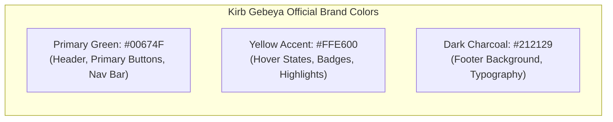

# Frontend Architecture, Blade Components & UX Audit — Kirb Gebeya

## 1. Frontend Architecture & Theme System

The front-office user interface is built on Laravel Blade templates integrated with Bootstrap 4, jQuery, and custom AIZ (Active IT Zone) frontend plugins.

### Theme Engine (`homepage_select: classic`)
The codebase contains four theme layouts in `public_html/resources/views/frontend/`:
- `classic/` — **The active theme on Kirb Gebeya**. Features a persistent category navigation drawer on the left of the desktop homepage, hero carousel slider, and stacked product showcase cards.
- `megamart/` — Horizontal category ribbon layout.
- `metro/` — Full-width slider layout with grid banners.
- `minima/` — Minimalist card-based layout.

---

## 2. Brand Identity & Visual Consistency



- **Primary Color**: `#00674F` (Forest Green). Configured via `business_settings.base_color` and dynamically injected into root CSS variables `--primary: #00674F`.
- **Accent / Hover Color**: `#FFE600` (Electric Yellow). Injected as `--hov-primary: #FFE600`.
- **Header Topbar**: Displays language switcher, default currency (`Ethiopian Birr`), seller registration CTA, and helpline (`+251974967171`).
- **Typography**: Uses `Public Sans` via Google Fonts. Clean and readable, though lacks dedicated Ethiopian font subsets (such as `Noto Sans Ethiopic` or `Abyssinica SIL`) for optimal Amharic rendering.

---

## 3. Component Hierarchy & Blade Structure

```
resources/views/frontend/
├── layouts/
│   ├── app.blade.php             <-- Master HTML5 document skeleton & asset includes
│   └── user_panel.blade.php      <-- Customer dashboard wrapper layout
├── inc/
│   ├── nav.blade.php             <-- Global header, search bar, language/currency, menu
│   ├── footer.blade.php          <-- Footer widgets, contact info, policy links
│   ├── floating_buttons.blade.php<-- Left-side circular floating quick-actions
│   └── demo_nav.blade.php        <-- Offsite demo toolbar (guarded by DEMO_MODE)
└── classic/
    ├── index.blade.php           <-- Homepage master layout
    └── partials/
        ├── category_menu.blade.php
        ├── home_slider.blade.php
        ├── todays_deal.blade.php
        ├── best_selling_section.blade.php
        └── cart.blade.php
```

---

## 4. Usability & User Journey Evaluation

### A. Homepage Experience
- **Strengths**: Prominent brand presence, clear hero banner advertising Ethiopian arrivals, accessible categories sidebar.
- **Weaknesses (Layout Shifts / CLS)**: The homepage loads its core product sections (`todays-deal`, `featured`, `best-selling`, `newest-products`) via asynchronous AJAX POST requests after the initial page render. On slower mobile networks common in Ethiopia, this causes noticeable content popping and Cumulative Layout Shift (CLS).

### B. Search Experience
- **Desktop Search**: Auto-complete dropdown triggers on keystroke (`/search/ajax`), displaying product thumbnail, title, and price.
- **Defects**: Search operates using raw SQL substring searches. Searching in Amharic script fails to match transliterated English product names (e.g., searching "ቲሸርት" will not find "T-Shirt").

### C. Shopping Cart & Checkout Funnel
- **Cart Access**: Dropdown cart in header and sticky floating cart indicator on mobile (`floating_buttons.blade.php`).
- **Checkout Friction**: Checkout requires multi-step page reloads (`checkout.shipping_info` -> `checkout.delivery_info` -> `checkout.payment_select`). A modern Ethiopian e-commerce experience benefits significantly from a streamlined single-page or two-step checkout with instant Telebirr/Chapa mobile prompt integration.

---

## 5. Responsive Breakpoint Inspection

| Viewport | Screen Width | Visual Quality | Key Usability Findings |
|---|---|---|---|
| **Mobile** | `< 768px` | **B** | Header collapses into mobile top bar with hamburger menu drawer. Bottom floating navigation bar provides quick access to Cart, Wishlist, and Categories. |
| **Tablet** | `768px - 1024px` | **B+** | Category menu collapses behind a toggle button. Slider banners adapt gracefully. |
| **Desktop** | `> 1024px` | **A-** | Full classic layout with persistent 270px category menu drawer beside the primary slider banner. |

### Mobile Friction Points
1. **Cookie Consent Banner**: The fixed bottom cookie banner can overlap the mobile bottom navigation bar on small devices (e.g., iPhone SE / 375px width), blocking taps on navigation icons until dismissed.
2. **Category Drawer Depth**: Deep category sub-menus on mobile require multiple accordion taps without clear "Back to Parent" breadcrumbs.
