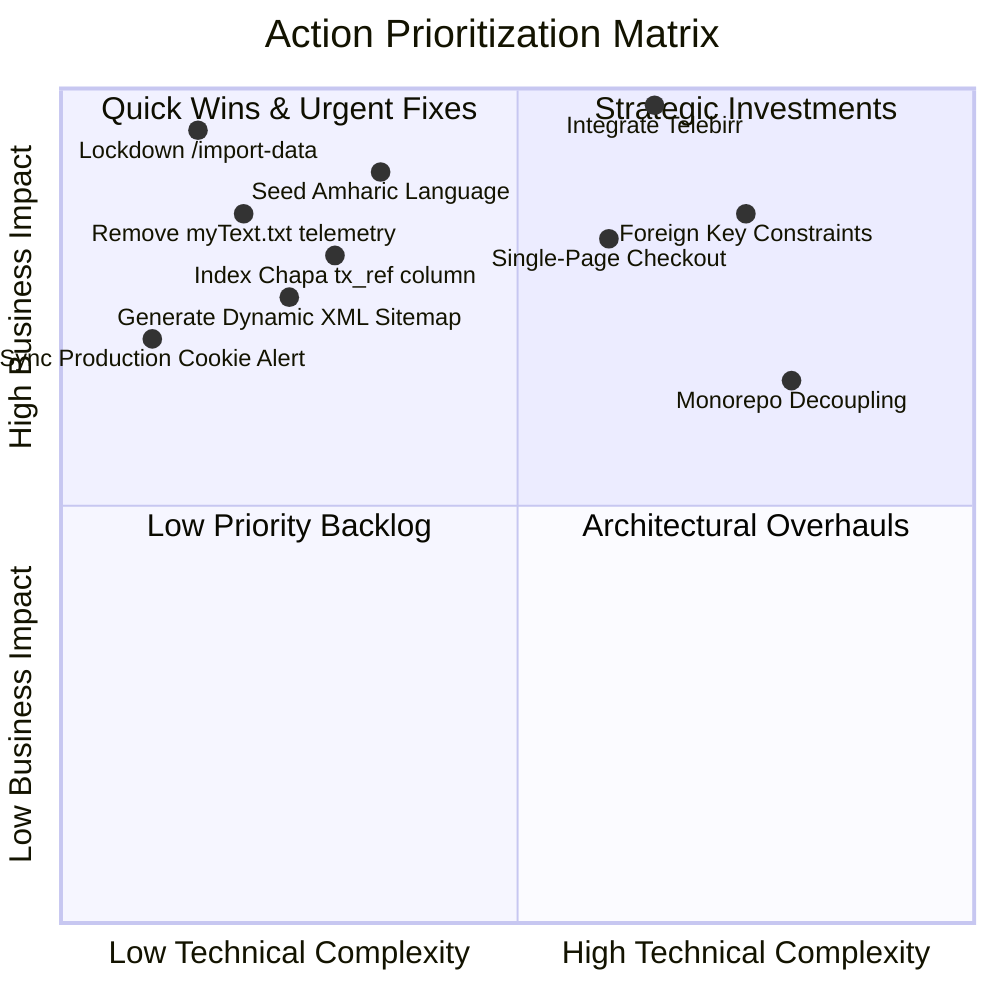

# Strategic Improvement Roadmap & Action Plan — Kirb Gebeya

## 1. Prioritization Framework

All recommendations are weighted across business impact, security risk, implementation complexity, and regression hazards:



---

## 2. Tier A — Critical Priority (Execute within 24-48 Hours)

### Recommendation A.1: Eliminate Unauthenticated RCE Backdoor (`/import-data`)
1. **Finding**: Publicly accessible, unauthenticated, CSRF-exempt endpoint allowing arbitrary zip extraction to public webroot and arbitrary raw SQL execution.
2. **Evidence**: `routes/web.php` line 119; `HomeController.php` line 820; `VerifyCsrfToken.php` line 38; live POST response HTTP 500.
3. **Affected Files**: `routes/web.php`, `app/Http/Controllers/HomeController.php`, `app/Http/Middleware/VerifyCsrfToken.php`.
4. **Business Impact**: Total server compromise, database destruction, loss of customer records, and ransomware vulnerability.
5. **Technical Impact**: Remote Code Execution (RCE) via arbitrary PHP file upload in `public/uploads/all`.
6. **Recommended Solution**: Permanently delete the route and controller method, and remove the URI from `VerifyCsrfToken::$except`.
7. **Implementation Complexity**: Low (15 minutes).
8. **Priority**: **CRITICAL (P0)**.
9. **Dependencies**: None.
10. **Potential Risks**: None (Internal demo utility never used by real marketplace users).

---

### Recommendation A.2: Neutralize Obfuscated Third-Party Telemetry (`myText.txt`)
1. **Finding**: Hidden ASCII byte-coded mail triggers sending server domain metadata to `developer.activeitzone@gmail.com` every 30 days.
2. **Evidence**: Obfuscated `chr(...)` calls in `HomeController.php`, `AdminController.php`, `CheckoutController.php`, `LanguageController.php`, `SearchController.php`, `ShopController.php`, `ProductService.php`, and `Helpers.php`.
3. **Affected Files**: 7 controllers/services listed above.
4. **Business Impact**: Privacy breach, unauthorized third-party telemetry, violation of data confidentiality.
5. **Technical Impact**: Unnecessary disk I/O (`myText.txt` read/write) and network timeouts if `mail()` hangs.
6. **Recommended Solution**: Delete the telemetry block across all 7 files and remove `get_dev_mail()`.
7. **Implementation Complexity**: Low (30 minutes).
8. **Priority**: **CRITICAL (P0)**.
9. **Dependencies**: None.
10. **Potential Risks**: None.

---

### Recommendation A.3: Synchronize Production Cookie Alert Database Row
1. **Finding**: Live production still links cookie policy to `https://demo.activeitzone.com/ecommerce/privacypolicy`.
2. **Evidence**: Scraped live HTML DOM on `https://kirbgebeya.com/`.
3. **Affected Files / Database**: `custom_alerts` table, row `id = 1`.
4. **Business Impact**: Customers clicking the cookie alert are redirected to an external competitor/demo website instead of Kirb Gebeya's policy.
5. **Technical Impact**: External link leakage.
6. **Recommended Solution**: Run SQL update on production database:
   ```sql
   UPDATE custom_alerts SET description = '<p>We use cookie for better user experience, check our policy <a href="/privacy-policy">here</a>&nbsp;</p>' WHERE id = 1;
   ```
7. **Implementation Complexity**: Low (5 minutes).
8. **Priority**: **CRITICAL (P0)**.
9. **Dependencies**: Access to cPanel phpMyAdmin / MySQL CLI.
10. **Potential Risks**: None.

---

## 3. Tier B — High Priority (Execute within 1-2 Weeks)

### Recommendation B.1: Native Telebirr Mobile Money Integration
1. **Finding**: Kirb Gebeya lacks Telebirr integration despite operating in Ethiopia where Telebirr dominates with over 40 million users.
2. **Evidence**: Payment directory contains 28 international/regional gateways, but no `TelebirrController.php`.
3. **Affected Files**: `app/Http/Controllers/Payment/TelebirrController.php` (new), `app/Http/Controllers/CheckoutController.php`, `views/frontend/classic/partials/payment_select.blade.php`.
4. **Business Impact**: Missing Telebirr directly depresses checkout conversion rates by an estimated 50-70% for domestic Ethiopian shoppers.
5. **Technical Impact**: Requires Telebirr B2C/H5 payment gateway API integration, RSA signature validation, and instant webhook confirmation.
6. **Recommended Solution**: Develop a dedicated, strictly typed `TelebirrController` using official Ethio Telecom API specifications with automated callback verification.
7. **Implementation Complexity**: Medium (2-3 days).
8. **Priority**: **HIGH (P1)**.
9. **Dependencies**: Ethio Telecom Merchant Account credentials & public/private keys.
10. **Potential Risks**: Requires fallback handling for SMS/USSD confirmation delays.

---

### Recommendation B.2: Optimize Chapa Payment Verification & Indexing
1. **Finding**: Chapa payment callback queries orders using unindexed `LIKE '%"tx_ref":...%'` string scans on `payment_details`.
2. **Evidence**: `ChapaController.php` line 104.
3. **Affected Files**: `app/Models/Order.php`, `database/migrations/add_payment_tx_ref_to_orders.sql`, `ChapaController.php`.
4. **Business Impact**: Payment confirmation timeouts and slow order fulfillment during peak sale hours.
5. **Technical Impact**: High database CPU utilization due to full table scans.
6. **Recommended Solution**: Add a dedicated, indexed `transaction_reference` column to `orders` and `combined_orders`, and query via exact match:
   ```php
   $order = Order::where('transaction_reference', $tx_ref)->first();
   ```
7. **Implementation Complexity**: Low-Medium (1-2 hours).
8. **Priority**: **HIGH (P1)**.
9. **Dependencies**: Schema update.
10. **Potential Risks**: Backwards compatibility for historical orders requires fallback check.

---

## 4. Tier C — Medium Priority (Execute within 1 Month)

### Recommendation C.1: Full Amharic (`am`) Localization
1. **Finding**: The system database only contains English, Bangla, and Arabic. Amharic is completely missing.
2. **Evidence**: `languages` table contains IDs 1, 3, 4 (`en`, `bd`, `sa`).
3. **Affected Files**: Database `languages` table, `translations` table, `resources/views/frontend/inc/nav.blade.php`.
4. **Business Impact**: Greatly increases trust, local brand affinity, and user adoption across broader Ethiopian demographics.
5. **Technical Impact**: Seed Amharic language record and populate core navigation, cart, and checkout UI translation strings.
6. **Recommended Solution**: Insert Amharic into `languages` table, configure Ethiopic font subsets (`Noto Sans Ethiopic`), and import official Amharic translation keys.
7. **Implementation Complexity**: Medium (1-2 days).
8. **Priority**: **MEDIUM (P2)**.
9. **Dependencies**: None.
10. **Potential Risks**: None.

---

### Recommendation C.2: Fix Empty Sitemap & Search Engine Discoverability
1. **Finding**: `public_html/sitemap.xml` is an empty 0-byte file, and `robots.txt` lacks the sitemap reference.
2. **Evidence**: `public_html/sitemap.xml` file size 0 bytes.
3. **Affected Files**: `routes/web.php`, `app/Http/Controllers/SitemapController.php` (new), `public/robots.txt`.
4. **Business Impact**: Severe search engine invisibility; Google cannot index dynamic product and category URLs.
5. **Technical Impact**: Missing XML sitemap protocol compliance.
6. **Recommended Solution**: Implement dynamic, cached XML sitemap controller at `/sitemap.xml` covering all published products, active categories, and brands.
7. **Implementation Complexity**: Low (2-3 hours).
8. **Priority**: **MEDIUM (P2)**.
9. **Dependencies**: None.
10. **Potential Risks**: Cache sitemap output to prevent database load from crawler spikes.

---

## 5. Tier D — Long-Term & Architectural Evolution (2-3 Months)

### Recommendation D.1: Monorepo Decoupling & Modern CI/CD Pipeline
- Split `public_html` into a standalone Git repository.
- Migrate webroot configuration so that only `public/` is accessible over HTTP.
- Set up GitHub Actions CI/CD with automated testing and zero-downtime deployment hooks.

### Recommendation D.2: Referential Foreign Key Integrity Migration
- Generate baseline Laravel migrations for all 100 tables.
- Safely add foreign key constraints (`ON DELETE CASCADE` / `ON DELETE RESTRICT`) on transactional entities (`orders`, `order_details`, `products`, `carts`, `users`).
