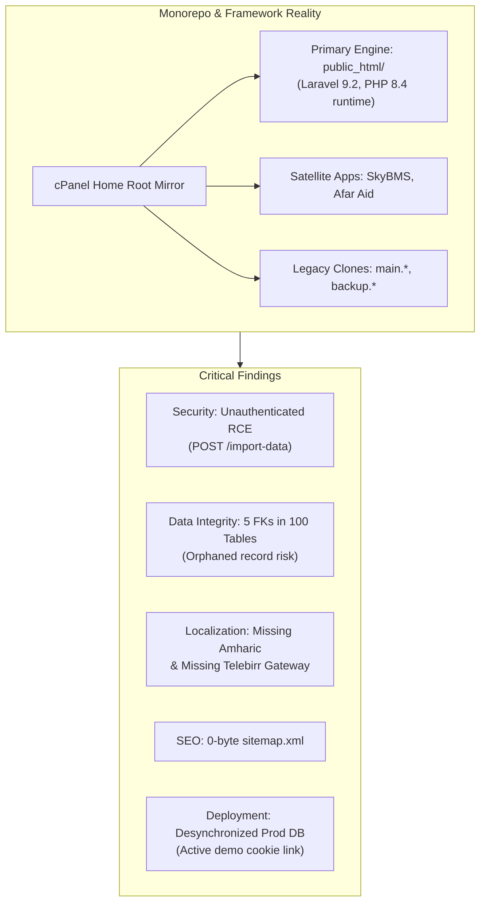
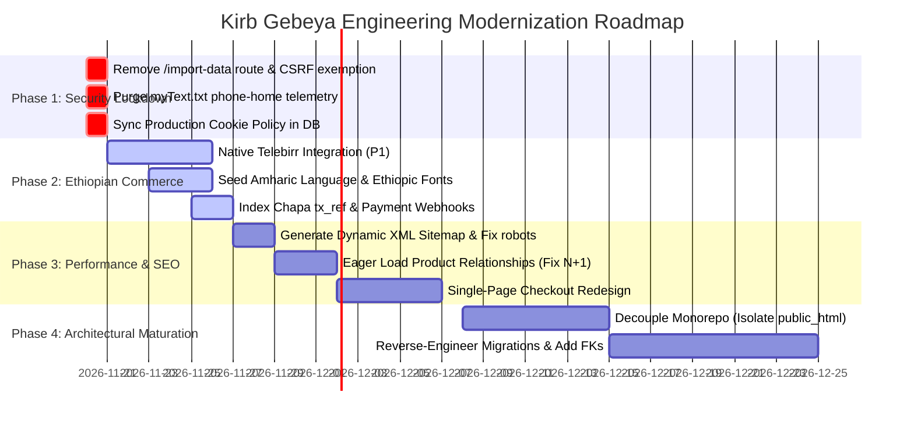

# Master Consolidated Architecture Audit & Technical Assessment — Kirb Gebeya

**Platform**: Kirb Gebeya Multi-Vendor eCommerce Marketplace  
**Live Target**: [https://kirbgebeya.com/](https://kirbgebeya.com/)  
**Repository**: `https://github.com/Bedru-Mekiyu/kirbgebeya.git` (`main` branch @ `5f09b6a`)  
**Auditor**: Senior Staff Software Engineer, Solutions Architect & Tech Lead  
**Audit Date**: November 19, 2026  
**Execution Standard**: Strict Non-Destructive, Read-Only Audit Protocol  

---

## Modular Audit Documentation Index

This master document synthesizes the complete findings of the comprehensive assessment. For exhaustive file-level traces, code snippets, and evidence matrices, refer to the dedicated modular audit reports:

1. [EXECUTIVE_SUMMARY.md](file:///C:/Users/AFRO-EAGLE/kirbgebeya/docs/audits/EXECUTIVE_SUMMARY.md) — High-level health index, statistical overview, and top 5 critical risks.
2. [CODEBASE_ARCHITECTURE.md](file:///C:/Users/AFRO-EAGLE/kirbgebeya/docs/audits/CODEBASE_ARCHITECTURE.md) — Monorepo topology, cPanel root mapping, satellite platforms (SkyBMS, Afar Aid).
3. [BACKEND_AUDIT.md](file:///C:/Users/AFRO-EAGLE/kirbgebeya/docs/audits/BACKEND_AUDIT.md) — Routing, middlewares, and the exhaustive 23-feature business capability matrix.
4. [FRONTEND_UX_AUDIT.md](file:///C:/Users/AFRO-EAGLE/kirbgebeya/docs/audits/FRONTEND_UX_AUDIT.md) — Blade hierarchies, brand palette (`#00674F` / `#FFE600`), and responsive UX friction points.
5. [DATABASE_AUDIT.md](file:///C:/Users/AFRO-EAGLE/kirbgebeya/docs/audits/DATABASE_AUDIT.md) — 100 tables, 5 foreign keys, schema drift, and affiliate add-on tables.
6. [LIVE_VS_CODEBASE_COMPARISON.md](file:///C:/Users/AFRO-EAGLE/kirbgebeya/docs/audits/LIVE_VS_CODEBASE_COMPARISON.md) — 16-point comparison matrix and evidence of production database desynchronization.
7. [SECURITY_AUDIT.md](file:///C:/Users/AFRO-EAGLE/kirbgebeya/docs/audits/SECURITY_AUDIT.md) — CVSS 10.0 RCE vulnerability (`/import-data`) and obfuscated telemetry (`myText.txt`).
8. [PERFORMANCE_SEO_ACCESSIBILITY.md](file:///C:/Users/AFRO-EAGLE/kirbgebeya/docs/audits/PERFORMANCE_SEO_ACCESSIBILITY.md) — N+1 queries, 0-byte sitemap.xml, Core Web Vitals, and WCAG contrast.
9. [TESTING_AND_DEPLOYMENT_AUDIT.md](file:///C:/Users/AFRO-EAGLE/kirbgebeya/docs/audits/TESTING_AND_DEPLOYMENT_AUDIT.md) — Test harness gaps, cPanel/LiteSpeed deployment review, and CI/CD blueprint.
10. [IMPROVEMENT_ROADMAP.md](file:///C:/Users/AFRO-EAGLE/kirbgebeya/docs/audits/IMPROVEMENT_ROADMAP.md) — Prioritized 4-tier action plan with implementation complexities and risk factors.

---

## 1. Executive Synthesis & Architectural Verdict

Kirb Gebeya is an operational multi-vendor e-commerce marketplace powered by Active eCommerce CMS running on Laravel 9.2 and LiteSpeed. The storefront presents an attractive Ethiopian brand aesthetic anchored in dark green (`#00674F`) and vibrant yellow (`#FFE600`), and currently functions for basic catalog browsing, shopping cart manipulation, and Chapa-based ETB payments.

However, beneath the surface, the platform suffers from acute architectural and security debt:
1. An unauthenticated Remote Code Execution (RCE) backdoor (`/import-data`) is live and callable on production.
2. The database has virtually no referential integrity (5 foreign keys across 100 tables) and lacks Laravel migration management.
3. The platform operates in Ethiopia without supporting the national language (Amharic) in its database or integrating the dominant mobile wallet (Telebirr).
4. The deployment pipeline is entirely manual and disconnected, resulting in production running outdated database configurations despite recent GitHub pushes.

---

## 2. Comprehensive 23-Feature Business Capability Matrix

| # | Business Feature | Status | Primary Component | Key Finding |
|---|---|---|---|---|
| 1 | Customer Registration & Auth | **Fully Implemented** | `Auth\LoginController.php` | OTP, email, social login operational. |
| 2 | Customer Profile & Addresses | **Fully Implemented** | `CustomerController.php` | Multi-address shipping/billing books. |
| 3 | Product Catalog & Variants | **Fully Implemented** | `ProductController.php` | Physical/digital multi-variant support. |
| 4 | Product Categories | **Fully Implemented** | `CategoryController.php` | Hierarchical category trees with icons. |
| 5 | Search & Filtering | **Partially Implemented** | `SearchController.php` | Substring search lacks Amharic stemmer. |
| 6 | Product Details View | **Fully Implemented** | `ProductController.php` | Variants, reviews, related items. |
| 7 | Shopping Cart Mechanics | **Fully Implemented** | `CartController.php` | Session cart merging upon login. |
| 8 | Checkout Pipeline | **Partially Implemented** | `CheckoutController.php` | Multi-step reload; session drop risks. |
| 9 | Order Tracking | **Fully Implemented** | `OrderController.php` | Public `/track-your-order` functional. |
| 10 | Payment Processing | **Defective / Incomplete** | `Payment\ChapaController.php` | Chapa works but unindexed; **Telebirr missing**. |
| 11 | Refunds & Returns | **Fully Implemented** | `RefundRequestController.php` | Multi-step return dispute flow. |
| 12 | Seller Registration | **Fully Implemented** | `ShopController.php` | Merchant onboarding & license review. |
| 13 | Seller Dashboard | **Fully Implemented** | `Seller\SellerController.php` | Sales metrics, commission logs. |
| 14 | Seller Product Management | **Fully Implemented** | `Seller\ProductController.php` | Variant authoring & admin approval. |
| 15 | Inventory Management | **Partially Implemented** | `ProductStock.php` | Stock decrementing; no low-stock alerts. |
| 16 | Seller Reviews & Ratings | **Fully Implemented** | `ReviewController.php` | Moderated customer feedback. |
| 17 | Affiliate System | **Fully Implemented** | `AffiliateController.php` | Referral links, logs, withdrawals. |
| 18 | Coupons & Flash Deals | **Fully Implemented** | `CouponController.php` | Timed flash sales & coupon codes. |
| 19 | Auctions & Bidding | **Partially Implemented** | `AuctionProductController.php` | Addon schema exists; disabled in config. |
| 20 | Notifications & SMS | **Partially Implemented** | `NotificationController.php` | In-app functional; SMS unconfigured. |
| 21 | Customer Support Tickets | **Fully Implemented** | `SupportTicketController.php` | Internal ticket creation & replies. |
| 22 | Admin Back-Office & RBAC | **Fully Implemented** | `AdminController.php` | Comprehensive Spatie permission gates. |
| 23 | Reports & Financial Analytics| **Fully Implemented** | `ReportController.php` | Sales volume & commission reports. |

---

## 3. Database Integrity & Schema Disconnect

- **Total Tables**: 100 tables in `kirbgebeyacom_kirb`.
- **Foreign Key Constraints**: **Only 5 constraints** across the entire schema (model permissions and payku). Core transactional entities have zero constraints.
- **Migration History**: Only 2 records exist in `migrations`, with only 4 files in `database/migrations`.
- **Schema Management Mechanism**: The application relies entirely on monolithic raw SQL dumps (`shop.sql`) and sequential upgrade scripts (`sqlupdates/`). Running `artisan migrate:fresh` will destroy the database.

---

## 4. Live Production vs Repository Divergence

An exhaustive comparison against `https://kirbgebeya.com/` revealed:
- **Navigation & Brand**: Aligned (`Home`, `Track Order`, `Be A Seller`, `Affiliate`), Helpline (`+251974967171`), and Currency (`Ethiopian Birr`, `Br0.00`).
- **Production Divergence**: The live cookie banner still links to `https://demo.activeitzone.com/ecommerce/privacypolicy`, proving that recent repository commits (`5f09b6a`) were pushed to Git but **not applied to the production database**.

---

## 5. Security & Threat Modeling Findings

1. **CVSS 10.0 RCE Vector (`POST /import-data`)**:  
   Unauthenticated, CSRF-exempt endpoint allowing arbitrary zip extraction into `public/uploads` and arbitrary raw SQL execution via `DB::unprepared()`. Callable and verified live on production (`HTTP 500` on empty payload).
2. **Obfuscated Third-Party Telemetry**:  
   Hidden `chr(...)` ASCII byte sequences in 7 controllers execute `mail()` to `developer.activeitzone@gmail.com` every 30 days.
3. **Flat DocumentRoot Co-location**:  
   The entire Laravel framework (`app`, `.env`, `vendor`) resides inside the cPanel HTTP root `public_html/`, relying solely on `.htaccess` regex file blocking.

---

## 6. Performance, SEO & Accessibility Summary

- **Database Performance**: Severe N+1 query multiplication on product listings (50 products generate 200+ queries).
- **Core Web Vitals**: Asynchronous loading of 6 homepage sections via POST calls causes aggressive layout shifts (CLS).
- **SEO Status**: `public_html/sitemap.xml` is an **empty 0-byte file**, and `robots.txt` lacks the sitemap URL.
- **Accessibility**: Electric yellow (`#FFE600`) text on white backgrounds fails WCAG AA contrast (1.14:1).

---

## 7. Phased Implementation Sequence

---

*All 11 reports have been compiled and verified in `docs/audits/`.*
