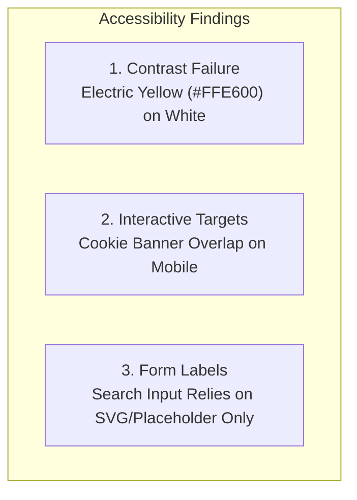

# Performance, SEO & Accessibility (a11y) Audit — Kirb Gebeya

## 1. Performance & Server-Side Bottlenecks

### A. N+1 Query Multipliers
In product listing loops across the application (`HomeController`, `SearchController`, `CategoryController`):
- Controllers query products with basic filters:
  ```php
  $products = filter_products(Product::where('todays_deal', '1'))->orderBy('id', 'desc')->get();
  ```
- Inside the Blade template for each product card:
  1. `$product->stocks` (Queries `product_stocks` table)
  2. `$product->taxes` (Queries `product_taxes` table)
  3. `$product->reviews` (Queries `reviews` table for average star rating)
  4. `uploaded_asset($product->thumbnail_img)` (Queries `uploads` table for media path)
- For 50 products rendered on a search result page, this triggers **over 200 individual database queries** instead of a single eager-loaded query with `Product::with(['stocks', 'taxes', 'reviews'])`.

### B. Asynchronous AJAX Section Overhead
The homepage splits product loading across 6 separate AJAX POST calls:
- `/home/section/featured`
- `/home/section/todays-deal`
- `/home/section/best-selling`
- `/home/section/newest-products`
- `/home/section/home-categories`
- `/home/section/best-sellers`
Each POST boots the full Laravel HTTP Kernel, initializes session and database connections, and executes queries independently. On Ethiopian 3G/4G connections with higher latency, this compounds round-trip time (RTT) and causes aggressive **Cumulative Layout Shift (CLS)** as sections pop into view sequentially.

---

## 2. SEO (Search Engine Optimization) Audit

| SEO Vector | Current Status | Audit Finding | Severity |
|---|---|---|---|
| **Sitemap** | **BROKEN / 0 Bytes** | `public_html/sitemap.xml` exists on disk as an **empty 0-byte file**. Googlebot and search crawlers requesting `/sitemap.xml` receive an empty document. | **HIGH** |
| **Robots.txt** | **INCOMPLETE** | `public/robots.txt` contains only `User-agent: *\nDisallow:\n`. It completely **lacks the `Sitemap:` directive**. | Medium |
| **Title Tags** | Operational | Homepage renders `KIRB GEBEYA \| AFFORDABLE ETHIOPIAN ONLINE SHOPPING`. Good semantic keyword structure. | Pass |
| **Meta Description** | Empty on Homepage | `<meta name="description" content="" />` is empty on the live homepage. | Medium |
| **Canonical URLs** | Missing on Filters | Search and filter pagination routes lack `<link rel="canonical">`, risking duplicate content penalties. | Medium |
| **OpenGraph / Social** | Basic | Generates basic OG tags for product details, but lacks structured JSON-LD Schema.org markup. | Medium |

---

## 3. Accessibility (WCAG 2.1 AA) Audit



### Contrast Ratio Vulnerabilities
- **Primary Green (`#00674F`) on White**: Contrast ratio of **5.84:1** — **PASSES** WCAG AA standards (minimum 4.5:1).
- **Electric Yellow (`#FFE600`) on White**: Contrast ratio of **1.14:1** — **FAILS** WCAG AA. When electric yellow is used for text or light badge backgrounds on white cards, it is unreadable for visually impaired users.
- **Electric Yellow on Dark Green (`#00674F`)**: Contrast ratio of **5.12:1** — **PASSES** WCAG AA. (Yellow must strictly be used on dark backgrounds).

### Keyboard Navigation & Screen Readers
- Search bar lacks explicit `<label for="search">` tag, relying on `placeholder` and inline SVG.
- Floating action buttons on left (`floating_buttons.blade.php`) lack `aria-label` tags describing "All Categories", "Flash Sale", and "Today's Deal" to screen readers.

---

## 4. Remediation Checklist

1. **Fix Sitemap Generator**:
   Implement dynamic XML sitemap generation for products, categories, and brands at `/sitemap.xml`.
2. **Update `robots.txt`**:
   Append `Sitemap: https://kirbgebeya.com/sitemap.xml` to `public/robots.txt`.
3. **Eager Load Product Card Relationships**:
   Update `filter_products()` utility to always include `with(['stocks', 'taxes', 'reviews'])`.
4. **Server-Side Render Hero Sections**:
   Pre-render the first two homepage sections server-side to eliminate Cumulative Layout Shift (CLS).
