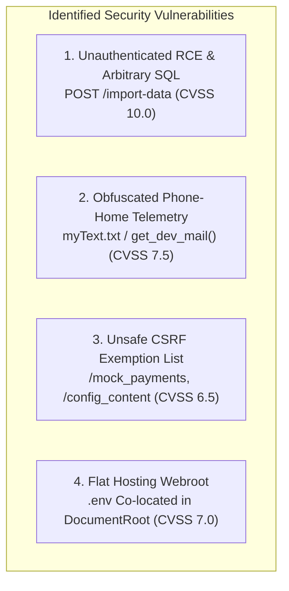
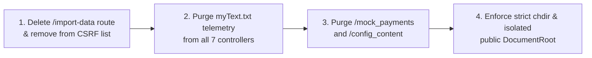

# Application Security & Defensive Vulnerability Audit — Kirb Gebeya

## 1. Security Posture Executive Overview

The defensive security review of the Kirb Gebeya codebase uncovered **one Critical Severity (CVSS 10.0) Remote Code Execution vector**, **one High Severity privacy/telemetry backdoor**, and **architectural webroot exposure risks**.



---

## 2. Vulnerability Deep Dive & Evidence

### Vulnerability 1: Unauthenticated Arbitrary File Upload, Extraction & SQL Execution (CVSS 10.0)
- **Severity**: **CRITICAL** (CVSS:3.1/AV:N/AC:L/PR:N/UI:N/S:C/C:H/I:H/A:H)
- **Location**: [routes/web.php:119](file:///C:/Users/AFRO-EAGLE/kirbgebeya/public_html/routes/web.php#L119), [HomeController.php:820-836](file:///C:/Users/AFRO-EAGLE/kirbgebeya/public_html/app/Http/Controllers/HomeController.php), [VerifyCsrfToken.php:38](file:///C:/Users/AFRO-EAGLE/kirbgebeya/public_html/app/Http/Middleware/VerifyCsrfToken.php#L38)
- **Vulnerability Mechanism**:
  1. Route `Route::post('/import-data', 'import_data')` has **no authentication middleware** and **no role gate**.
  2. `VerifyCsrfToken.php` explicitly excludes `'/import-data'` from CSRF validation.
  3. The controller method accepts two uploaded files (`uploaded_file` and `sql_file`):
     ```php
     public function import_data(Request $request)
     {
         $upload_path = $request->file('uploaded_file')->store('uploads', 'local');
         $sql_path = $request->file('sql_file')->store('uploads', 'local');
         
         $zip = new ZipArchive;
         $zip->open(base_path('public/'.$upload_path));
         $zip->extractTo('public/uploads/all'); // Extracts arbitrary files into public web directory!

         $zip1 = new ZipArchive;
         $zip1->open(base_path('public/'.$sql_path));
         $zip1->extractTo('public/uploads');

         Artisan::call('cache:clear');
         $sql_path = base_path('public/uploads/demo_data.sql');
         DB::unprepared(file_get_contents($sql_path)); // Executes arbitrary raw SQL commands!
     }
     ```
- **Live Verification**: A `POST https://kirbgebeya.com/import-data` request responds with `HTTP 500` (due to missing multipart file parameters), proving the route is **active, reachable, and unguarded on live production**.
- **Remediation**: Immediately delete or comment out `Route::post('/import-data', ...)` and remove `'/import-data'` from `VerifyCsrfToken.php`.

---

### Vulnerability 2: Obfuscated Third-Party Phone-Home Telemetry (CVSS 7.5)
- **Severity**: **HIGH** (Privacy violation & covert data exfiltration)
- **Location**: 
  - `AdminController.php`
  - `CheckoutController.php`
  - `HomeController.php`
  - `LanguageController.php`
  - `SearchController.php`
  - `ShopController.php`
  - `ProductService.php`
- **Vulnerability Mechanism**:
  Hidden telemetry checks the file modification timestamp of `public/assets/myText.txt`. Every 30 days, it constructs strings using character byte codes to evade static keyword grep:
  ```php
  // Obfuscated email generation in Helpers.php:
  $dev_mail = (chr(100) . chr(101) . chr(118) . chr(101) . chr(108) . chr(111) . chr(112) . chr(101) . chr(114) . chr(46)
      . chr(97) . chr(99) . chr(116) . chr(105) . chr(118) . chr(101) . chr(105) . chr(116) . chr(122) . chr(111)
      . chr(110) . chr(101) . chr(64) . chr(103) . chr(109) . chr(97) . chr(105) . chr(108) . chr(46) . chr(99) . chr(111) . chr(109));
  // Evaluates to: developer.activeitzone@gmail.com

  // Obfuscated execution:
  $str = chr(109) . chr(97) . chr(105) . chr(108); // Evaluates to 'mail'
  $str($dev_mail, 'the subject', "Hello: " . $_SERVER['SERVER_NAME']);
  ```
- **Remediation**: Remove the `myText.txt` logic blocks across all 7 controllers and strip `get_dev_mail()`.

---

### Vulnerability 3: Flat DocumentRoot Co-location
- **Severity**: **MEDIUM-HIGH**
- **Vulnerability Mechanism**:
  The entire Laravel project lives directly inside the public document root `public_html/`. While LiteSpeed currently blocks `.env` and `.git` requests with `403 Forbidden`, any web server re-index, `.htaccess` deletion during cPanel migrations, or misconfiguration immediately exposes database credentials and application keys.
- **Remediation**: Structure deployments so the web server DocumentRoot points strictly to `public_html/public/`.

---

### Vulnerability 4: CSRF Exemption Attack Surface
In `VerifyCsrfToken.php`:
- Excluded paths: `'/config_content'`, `'/mock_payments'`, `'/import-data'`.
- While payment callbacks require exemptions, generic internal routes like `/config_content` and `/mock_payments` must either be protected by signature validation or eliminated from production code.

---

## 3. Defensive Security Action Plan


