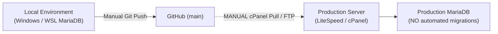
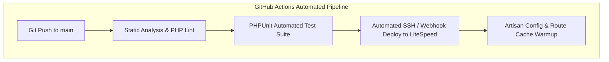

# Testing Harness & Deployment Pipeline Audit — Kirb Gebeya

## 1. Automated Testing Baseline & Gaps

### The 0% Coverage Reality
Inspection of `public_html/tests/` reveals an alarming lack of automated verification:
```
public_html/tests/
├── CreatesApplication.php
├── TestCase.php
├── Feature/
│   └── ExampleTest.php       <-- Default Laravel test checking route '/' returns 200
└── Unit/
    └── ExampleTest.php       <-- Default test asserting true === true
```
- **Application Test Coverage**: **0.0%**.
- No tests exist for:
  - Order creation and cart total calculation.
  - Chapa payment initiation and callback signature verification.
  - Multi-vendor commission calculations.
  - Affiliate referral code tracking and commission assignment.
  - Stock decrementing race conditions during simultaneous checkout.

---

## 2. Test Execution Harness Evaluation

While `public_html/vendor/bin/phpunit` is installed (PHPUnit 9.6.19), executing `php artisan test` on Windows encounters CLI wrapper path failures. Furthermore, executing test suites requires a live database connection because models and global helpers (`get_setting()`, `uploaded_asset()`) cannot be mocked without database access.

### Recommended Test Architecture
To introduce professional testing without breaking production:
1. Configure SQLite in-memory database in `phpunit.xml`:
   ```xml
   <server name="DB_CONNECTION" value="sqlite"/>
   <server name="DB_DATABASE" value=":memory:"/>
   ```
2. Build dedicated Unit & Feature test suites for:
   - Currency formatting (`ETB` conversion).
   - Chapa callback parsing.
   - User authentication and role guards.

---

## 3. Deployment Architecture & Infrastructure Audit



### Current Deployment Workflow
1. **Manual Git Push**: Changes committed locally and pushed to GitHub `origin/main`.
2. **Disconnected Production Update**: Production does not utilize automated deployment webhooks or CI/CD pipelines. Changes must be manually pulled or uploaded via cPanel File Manager / FTP.
3. **Database Migration Disconnect**: Because database changes are not encapsulated in Laravel migrations, database updates (such as updating `custom_alerts` cookie links or adding currencies) must be manually run via phpMyAdmin or SQL import.
4. **Zero-Downtime Deployment**: Completely absent. Code updates risk transient fatal errors during active customer checkout if files are updated mid-execution.

---

## 4. Proposed Production-Grade CI/CD Blueprint



### Immediate Deployment Recommendations
1. **Implement GitHub Actions Workflow**:
   Create `.github/workflows/deploy.yml` to automatically run syntax checks and trigger cPanel Git Version Control deployment.
2. **Automate Cache Invalidation**:
   Post-deployment commands must execute:
   ```bash
   php artisan config:clear
   php artisan route:clear
   php artisan view:clear
   php artisan cache:clear
   ```
3. **Strict Database Change Logging**:
   Store all schema changes as sequential, idempotently written SQL scripts in `database/sql_updates/` with automated execution tracking.
